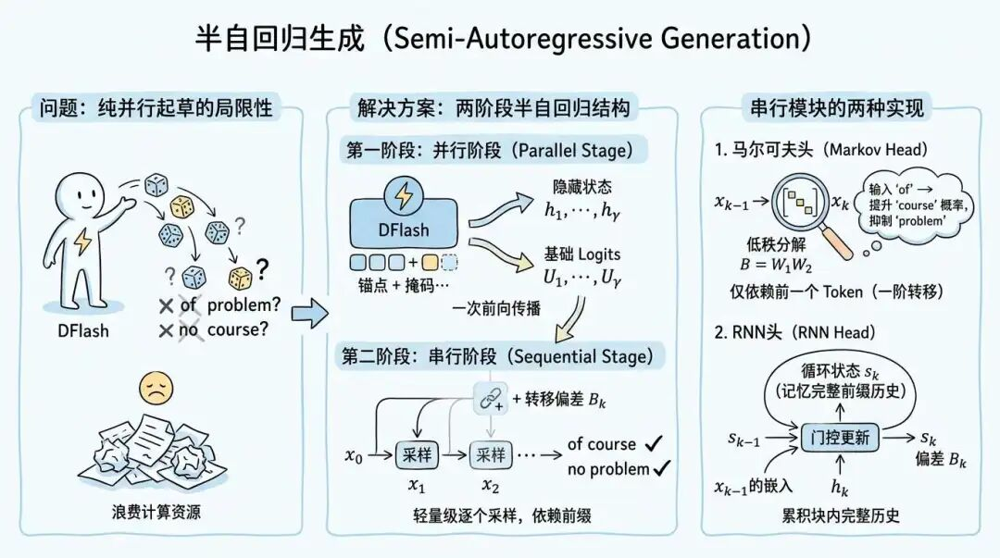
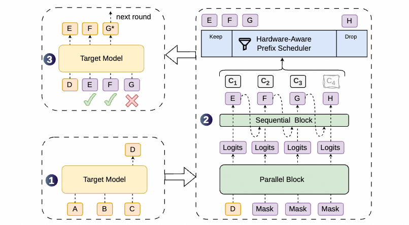
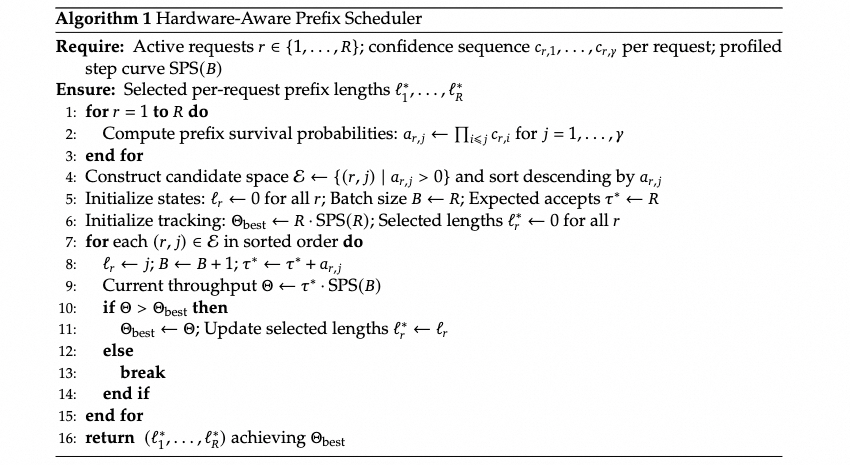
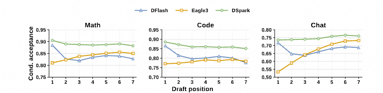
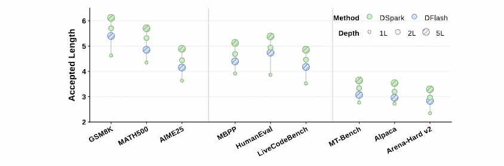
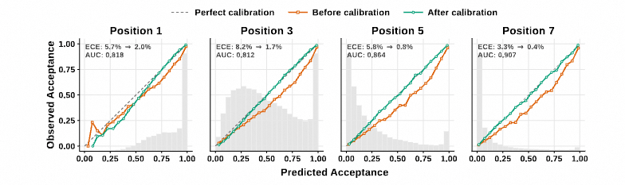
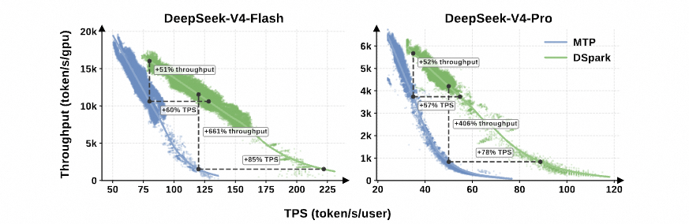
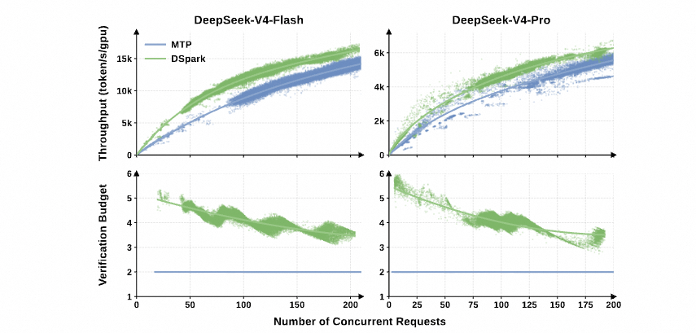

## Summary
[[Zartbot]] presents [[SpeculativeDecoding]] as a three-variable performance problem joining draft quality, draft cost, and proposal length, then traces the field from small autoregressive draft models through token trees, feature-level heads, multi-token prediction, and parallel diffusion drafting. The main subject is [[DSpark]], which combines a deep parallel draft backbone with a lightweight sequential correction head, then uses calibrated acceptance estimates and the measured hardware throughput curve to decide how much of each request's draft prefix to verify. The article's most important systems claim is that a draft method cannot be judged only by single-request acceptance or latency: under concurrency, low-value verification consumes batch capacity that could serve other requests.

## Key Claims
- Exact speculative sampling can preserve the target model's output distribution by accepting a draft token with probability `min(1, p_target / p_draft)` and, after rejection, sampling from the normalized positive residual `max(0, p_target - p_draft)`; acceptance proceeds only along a contiguous prefix.
- Expected speed depends jointly on acceptance rate, relative draft cost, proposal length, and verification cost. Longer drafts help only while their expected accepted-token yield exceeds their drafting and batch-capacity cost.
- Parallel diffusion drafting reduces draft latency from roughly linear in block length to nearly constant, but independent position predictions suffer suffix decay because they do not condition on the actual sampled within-block prefix.
- [[DSpark]] keeps the parallel backbone and adds a low-cost Markov or RNN head that applies prefix-dependent logit corrections sequentially, recovering much of the coherence of autoregressive drafting without repeating the expensive backbone.

- The end-to-end path drafts a block, corrects its logits sequentially, estimates conditional acceptance at each position, schedules a prefix, verifies it with the target model, and carries the accepted prefix plus correction token into the next cycle.

- The confidence head predicts conditional per-position acceptance. Sequential temperature scaling calibrates cumulative prefix survival probabilities because throughput optimization needs probability magnitudes, not merely a ranking.
- The hardware-aware prefix scheduler ranks prefix extensions by cumulative survival probability and chooses verification lengths to maximize expected accepted tokens times the profiled steps-per-second curve at the resulting batch size.

- Training freezes the target model and shared embeddings and LM head, while optimizing the draft backbone, sequential head, and confidence head with position-weighted cross-entropy, target-distribution L1 matching, and confidence losses.
- Position-level experiments attribute DSpark's advantage to a deep parallel model's stronger first prediction and the sequential head's reduction of later suffix decay.

- Confidence calibration reduces the reported expected calibration error from roughly 3–8% before calibration to about 1%, supporting cumulative survival estimates used by the scheduler.

- In reported preview-model production telemetry, DSpark shifts the throughput-versus-per-user-speed frontier outward and reduces its average verification budget as concurrency rises.

## Key Quotes
> “投机解码的第一性原理可以用一个公式精确描述: L = (T_draft + T_verify) / τ.” — framing accepted tokens per cycle against draft and verification wall time.

> “验证一个草稿 token 的效用在很大程度上取决于当前的系统负载.” — why a fixed confidence threshold is insufficient for production serving.

## Connections
- [[DSpark]] - semi-autoregressive draft architecture and hardware-aware verification system analyzed in detail.
- [[SpeculativeDecoding]] - broader draft-and-verify framework, correctness argument, performance model, and historical lineage.
- [[TextGenerationSampling]] - target and draft distributions, temperature, rejection sampling, and correction sampling determine output behavior.
- [[AttentionMechanism]] - bidirectional draft blocks, ancestor-only tree masks, KV injection, and target verification are all expressed through attention structure.
- [[InferenceHostOverhead]] - production gains depend on scheduling and physical execution paths as well as model-level draft quality.
- [[DeepSeekV41Flash]] - later represented DeepSeek model whose broader architecture also includes DSpark draft blocks.

## Contradictions
- No direct contradiction with the existing wiki was found. The source extends the inference material by adding speculative draft-and-verify behavior and load-aware verification.
- The article distinguishes exact speculative sampling from DFlash's simpler sample-and-compare verification, noting that the latter is not distribution-exact for nonzero temperature; performance comparisons should not erase that correctness boundary.
- The JetSpec section questions whether ancestor-masked processing of representations originating from mask tokens constitutes true token-level autoregressive conditioning. This is the author's interpretation, not an experimentally resolved contradiction.
- All architecture, ablation, calibration, and production figures are reproduced or interpreted by one secondary technical article. The reported 406–661% throughput ratios occur where MTP-1 is near its operating boundary; the source itself treats matched-capacity 57–85% user-speed gains and moderate-SLA 51–52% throughput gains as more stable comparisons.
- Fixed full-block drafting remains unrecoverable overhead on intrinsically low-acceptance queries, and the scheduler's optimality depends on calibrated probabilities, an accurate hardware profile, prefix causality, and production-specific capacity behavior.
