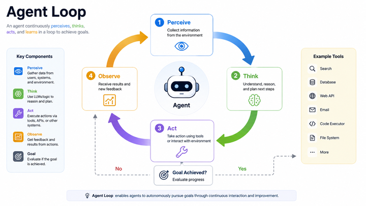
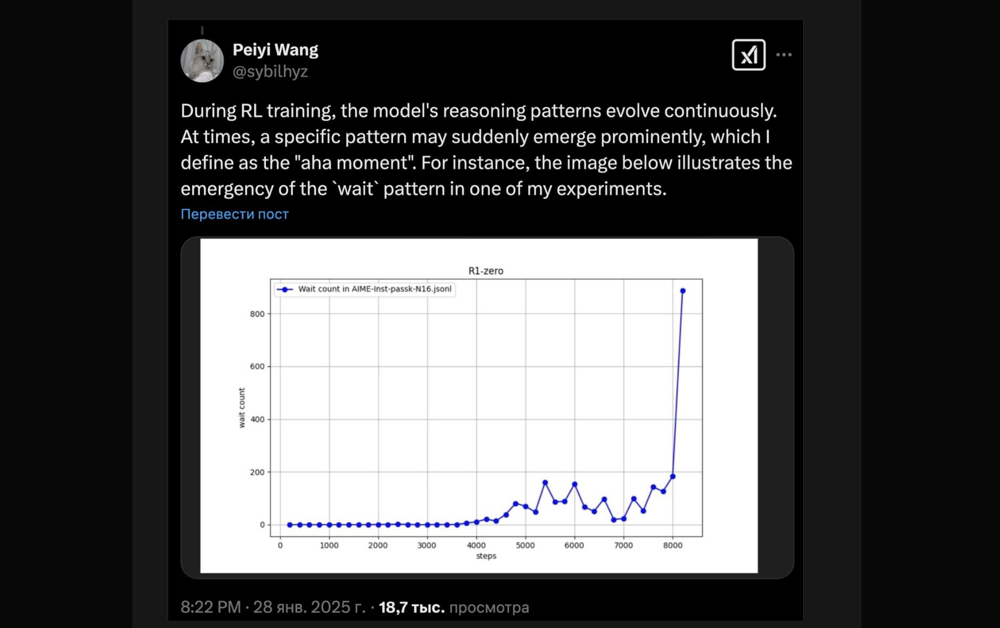
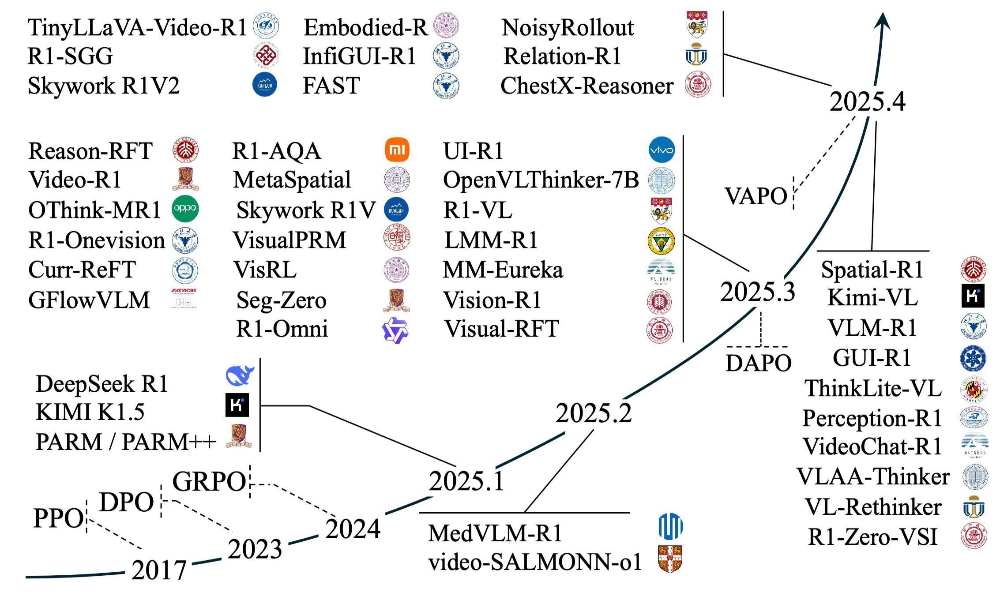
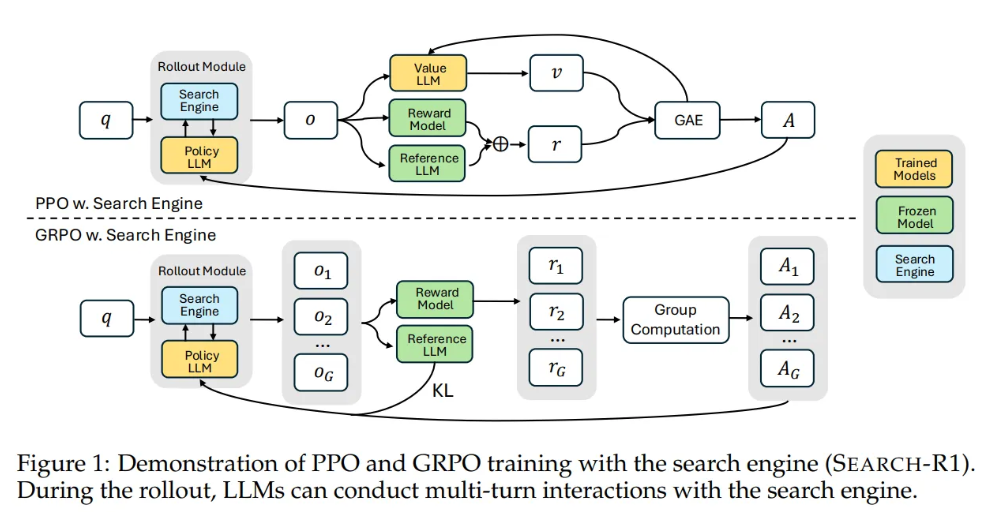
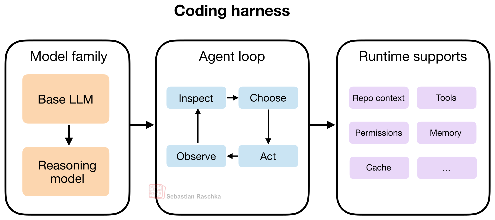

## Summary
This practitioner review argues that post-training is moving from preference alignment and single-turn reinforcement learning with verifiable rewards toward [[AgenticReinforcementLearning]], where a model learns a multi-step policy through tools and mutable environments. It attributes the shift to open-world information needs, environment-grounded task rewards, learnable meta-decisions, new scaling dimensions, business demand for completed work, and reusable RL infrastructure. It also treats long-horizon credit assignment, reasoning collapse, environment reliability, reward hacking, and asynchronous policy staleness as first-class constraints rather than implementation details.

## Key Claims
- Single-turn RLVR treats the token context as state, the next token as action, deterministic concatenation as transition, and a final verifier score as reward; agentic RL extends state into files, databases, browsers, and other mutable systems, with stochastic observations and potentially step-level feedback.

- The source's core distinction is between optimizing one answer and optimizing a distribution over behavior trajectories: the policy must inspect, act, observe consequences, recover, and decide when to stop.
- RLVR remains valuable on mathematics, code, and constrained formats, but its closed-book prompt and single terminal verifier do not cover tasks whose missing facts and success conditions live in external state.
- Outcome reward can induce unprompted reasoning patterns. The retained R1-Zero screenshot shows a reported late-training surge in the count of the token pattern “wait,” but it is one social-media chart rather than a full causal experiment.

- The illustrated 2023–April 2025 timeline shows RLVR expanding from PPO, DPO, and GRPO into many visual, spatial, GUI, video, and medical projects; it supports breadth and chronology, not comparative effectiveness.

- Teacher-trajectory SFT is presented as a useful but bounded route for agents because teacher errors set a ceiling, deviations compound over many turns, and imitation data does not directly reward recovery after entering an off-demonstration state.
- The proposed advantages of agentic RL are environment-readable task completion, feedback for tool timing and recovery decisions, scaling through environments and interaction rather than parameters alone, closer alignment with coding and workflow revenue, and reuse of PPO/GRPO plus asynchronous rollout infrastructure.
- [[SearchR1]] illustrates an early implementation: a policy and search engine interact during rollout, while PPO uses a value model and GAE and GRPO compares a group of complete rollouts.

- Long trajectories make sparse terminal rewards hard to assign to individual decisions. The article reports that process penalties can suppress useful exploration and that unequal compacted segments can invalidate naive group normalization.
- Reward and entropy curves may miss template collapse. The review recommends monitoring whether outputs retain information about inputs and filtering prompts with no within-task reward variance, while acknowledging that the cited ranges and prescriptions are secondary reports.
- Environments are simultaneously training data, verifiers, and infrastructure dependencies: non-determinism, incorrect observations, limited concurrency, leaked answers, or writable tests can corrupt the learned policy.
- Agentic reward hacking can alter tests, read ground truth, or disable checkers; the article therefore recommends red-teaming the environment with a strong model before RL rather than treating successful checks as proof of legitimate completion.
- Variable rollout length favors asynchronous generation but creates off-policy training from stale trajectories, making freshness bounds, importance correction, and cross-policy sampling part of the algorithm.
- Agent performance depends on the surrounding [[HarnessEngineering]] layer—tools, repository context, permissions, memory, cache, and the inspect-choose-act-observe loop—not only on model weights.

## Key Quotes
> “RLHF 解决‘说得像人’，RLVR 解决‘答得对’，agentic RL 解决‘把事办成’。” - the article's compressed account of the post-training shift.

> “环境就是 verifier。” - on reading task success from environment state.

> “你最该投人的就是‘环境 + harness’这一层。” - on the infrastructure bottleneck.

## Connections
- [[AgenticReinforcementLearning]] - central post-training approach synthesized from the article.
- [[ReinforcementLearning]] - parent framework for policy learning from outcome and process feedback.
- [[MarkovDecisionProcess]] - formal lens used to contrast token-only and environment-coupled state transitions.
- [[GroupRelativePolicyOptimization]] - critic-free grouped optimizer whose normalization becomes difficult for long and unequal trajectories.
- [[AsynchronousReinforcementLearning]] - throughput response that introduces policy lag and off-policy correction requirements.
- [[AgenticSandboxInfrastructure]] - execution layer whose stability, isolation, concurrency, and recoverability determine reward quality.
- [[InstructionRewardAlignment]] - captures the gap between intended completion and shortcuts rewarded by a verifier.
- [[HarnessEngineering]] - tools, permissions, memory, context, and control loop surrounding the trained model.
- [[SearchR1]] - example of multi-turn search inside a policy-optimization rollout.

## Contradictions
- Calling environment reward “free” conflicts with the article's own evidence that realistic environments are expensive to build, scale, stabilize, secure, and audit; environment state can provide a direct signal without making the verifier costless or correct.
- The article presents agentic RL as the convergent direction for valuable work, but many reported benchmark and model comparisons are secondary summaries without matched budgets, full methods, uncertainty, or independent replication.
- Sparse outcome reward avoids labeling every action but does not solve credit assignment, reward hacking, or illegitimate success; process reward can add information while also suppressing exploration when misspecified.
- The critique of SFT bounds pure imitation, not all supervised data: demonstrations can still provide cold starts, formats, tool syntax, safety behavior, or curriculum before and alongside online RL.
