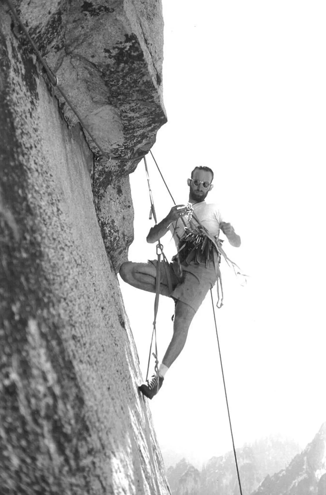

## Summary
[[Earendil]] explains an agent harness through a climbing-harness analogy: software surrounds a model with instructions, tools, an agentic loop, and a model-provider translation layer. The article argues that a user-owned, locally run, extensible harness such as [[PiAgentHarness]] can preserve model choice, local session custody, and workflow control, while remaining an introductory and interested-party account rather than a security, portability, or comparative evaluation.

## Key Claims
- An agent harness is the software environment in which a model operates, not the model itself; the simplified relation is agent = model + harness.
- A harness generally supplies four functions: a system prompt, callable tools, an agentic loop, and a translation layer across model providers.
- The model usually chooses when and how to call available tools, while the loop returns results to the model so it can inspect progress, retry, change course, and decide when work is complete.
- A provider translation layer can let one harness compare or switch among proprietary and open-weight models, potentially separating a user's workflow and retained sessions from any one AI lab's application.
- [[PiAgentHarness]] is presented as a minimal, free, open-source, locally run harness whose users can alter instructions and add shared extensions.
- The climbing photograph grounds the analogy visually: the physical harness supports and constrains the climber while carrying modular tools, just as software attaches instructions and capabilities around a model.

## Key Quotes
> “An agent harness is a piece of software that provides an environment for an AI model to operate within.” - on the article's core definition.

> “Agent = Model + Harness.” - on the simplified separation between model capability and its operating environment.

## Connections
- [[HarnessEngineering]] - the article supplies a compact component model and an end-user ownership argument for harness design.
- [[PiAgentHarness]] - principal minimal and extensible harness example in the article.
- [[Earendil]] - publisher and interested party presenting Pi and Lefos as its own harness work.
- [[AgenticWorkflowPatterns]] - the search, inspect, retry, spreadsheet, and email example illustrates a model-directed tool loop.
- [[OpenClaw]] - example of a harness exposed through messaging interfaces rather than only a terminal.
- [[ClaudeCode]] - described as the first popular coding harness, though not as a provider-neutral translation layer.
- [[HumanAgencyInAI]] - local ownership, model choice, customization, and session custody are framed as sources of user agency.

## Contradictions
- The four-part model is explicitly introductory and simplified. Existing wiki sources show that production harnesses may also need context management, persistence, observability, permissions, isolation, effect recovery, evaluation, and human checkpoints.
- Earendil promotes a harness it says it is building and gives no reproduced interoperability test, security audit, extension-quality study, user count denominator, or evidence that local ownership by itself prevents provider dependence or unsafe tool use.
- The claim that Pi users have shared more than 5,000 extensions is a point-in-time publisher figure without a counting method, activity measure, quality review, or security analysis.
