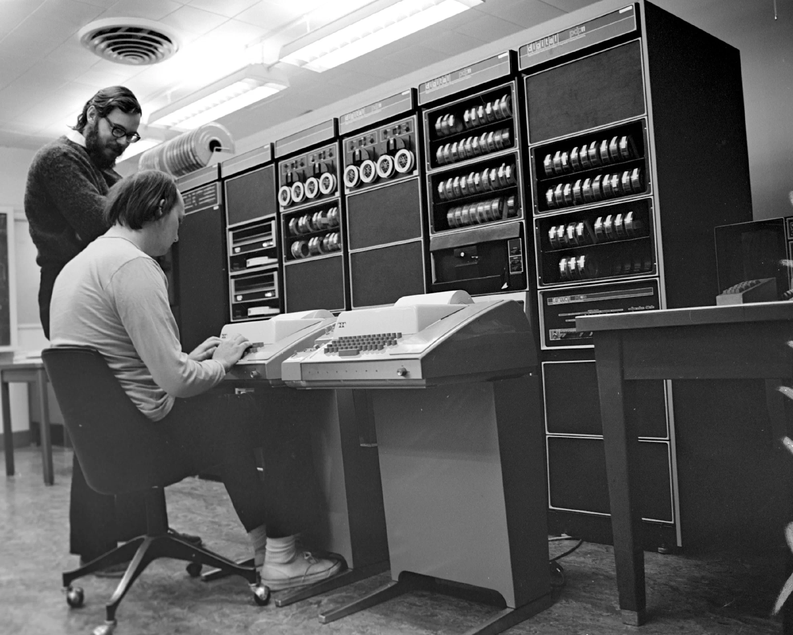
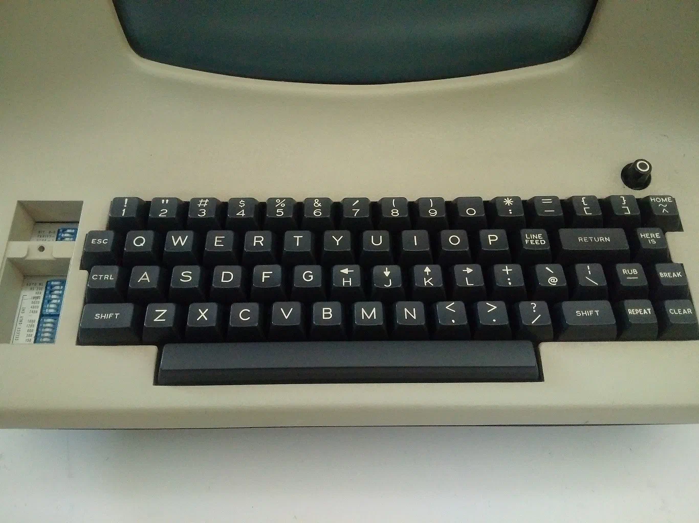

## Summary
Jinglue's Chinese translation of Sinclair Target's 2018 history traces Vim from Ken Thompson's QED-derived `ed`, through George Coulouris's `em` and Bill Joy's `ex`/`vi`, to Bram Moolenaar's STEVIE-based Vim. It argues that Vim's apparently arbitrary commands are accumulated responses to older hardware, licensing, and compatibility constraints, and that long-running collaboration and iteration can be as consequential as clean-slate invention.

## Key Claims
- [[KenThompson]] simplified QED into Unix `ed`, which supplied modal input, `w` and `q`, and `s/foo/bar/g` substitution syntax that still appear in [[Vim]].
- The move from paper teletypes to video terminals made line-at-a-time `em`, full-screen `ex`, and the visual-mode `vi` interface possible.

- [[BillJoy]] released `ex` with the first BSD in 1978, while the 1979 second BSD added a `vi` executable that launched `ex` directly in visual mode.
- The ADM-3A keyboard explains both `h/j/k/l` navigation—those keys carried arrow markings—and why `Esc` was originally convenient despite its remote position on modern keyboards.

- AT&T source licensing encouraged independent `vi` clones such as STEVIE, Elvis, and nvi; some clone features later flowed into Vim.
- [[BramMoolenaar]] began from STEVIE on the Amiga in 1988, first released "Vi Imitation" in 1991, and steadily added compatibility, undo, quickfix, splits, buffers, recovery, Vimscript, and syntax highlighting.
- Vim's longevity rests on backward-compatible accumulation across several implementations, distribution channels, and contributor generations rather than on one isolated codebase.

## Key Quotes
> “Vim 不过是一款软件的最新迭代版本。” — the article's framing of editor lineage

> “协作与迭代，同样能创造奇迹。” — the concluding lesson drawn from Vim's history

## Connections
- [[Vim]] - contemporary editor whose commands, features, and culture the article explains.
- [[KenThompson]] - QED and `ed` developer at the start of the documented Unix editor lineage.
- [[BillJoy]] - Berkeley developer who turned the line-editor family into `ex` and visual `vi`.
- [[BramMoolenaar]] - creator and long-term developer of Vim from the STEVIE codebase.
- [[UnixEditorLineage]] - the source's central chain from QED and `ed` through `vi` clones to Vim.
- [[ConstraintShapedInterfaceDesign]] - teletypes, video terminals, keyboard layout, licensing, and distribution shaped persistent behavior.
- [[ProductEvolution]] - Vim is presented as cumulative, compatibility-preserving product evolution.

## Contradictions
- No direct contradiction with the existing Vim history note was found. The existing note includes the intermediate `en` editor, Chuck Haley's collaboration, and 300-baud constraints, while this account compresses that part of the chronology and emphasizes `ex`/`vi`, keyboard layout, and feature inheritance.
