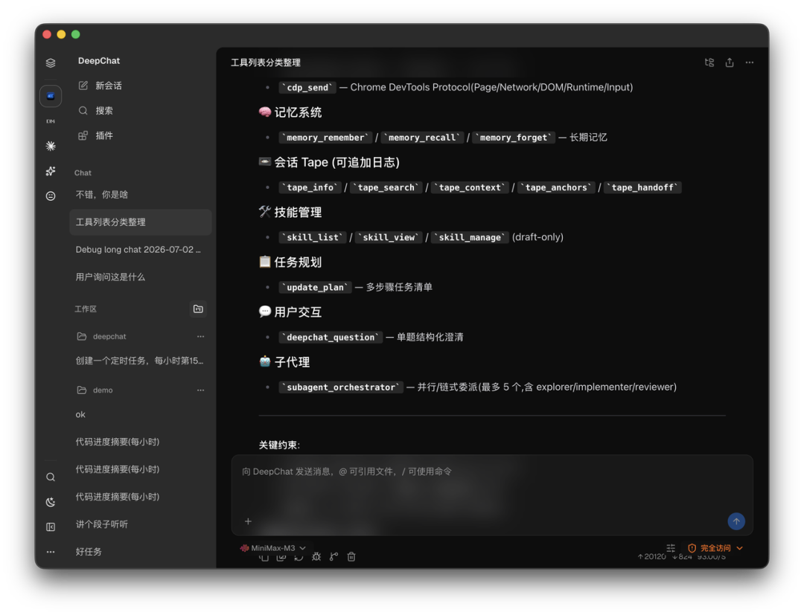

## Summary
DeepChat developers 夕阳针 and 灰灰 describe the project's transition from a Vue chatbot into a [[LocalFirstSoftware|local-first]] desktop [[DeepChat|agent client]] combining model access, [[ModelContextProtocol|MCP]], [[LLMToolingSkills|Skills]], [[ComputerUse]], and [[AgentMemory]]. The implementation treats [[TapeAndAnchors|Tape]] as an append-only evidence ledger and Memory as a derived, inspectable layer of durable conclusions with admission, conflict, decay, provenance, and bounded-recall policies. The interview also documents productization work around provider metadata, bundled MCP runtimes, permission modes, encrypted local data, and a Cua-backed Computer Use bridge, while acknowledging incomplete memory self-update, safety, ACP compatibility, and evaluation.

## Key Claims
- [[LocalFirstSoftware]] puts conversations, files, memories, model credentials, and workspace context on the user's machine so an agent can use richer personal context while reducing default data transfer; local storage still needs encryption, access control, and explicit export.
- [[DeepChat]] moved from a chatbot to a general agent client during a three-to-four-month rewrite, then restored a separate chat mode because some users still wanted the simpler interaction model.
- [[AgentMemory]] is not equivalent to embedding chat logs: the proposed lifecycle admits only minimal durable conclusions, compares candidates with similar memories, records rather than overwrites conflicts, soft-archives unused items, and recalls only a token-bounded subset.
- [[TapeAndAnchors|Tape]] records structured messages, tool calls and results, runtime events, and anchors as traceable evidence; Memory derives current conclusions while retaining pointers back to the original passages.
- [[ModelContextProtocol]] became product-usable through SSE, stdio, and in-memory integration plus bundled Node.js and Python runtimes, `uv` dependency management, and automatic mirror selection rather than requiring users to prepare development environments.
- [[LLMToolingSkills]] act as instructions for how to use capabilities, while MCP supplies tools and resources; DeepChat's Computer Use combines a Cua driver, an MCP server, and a Skill explaining the workflow.
- Model access is split between shared AI SDK primitives, provider-specific routing and cache-aware adaptations, and an externally maintained metadata repository that agents poll and update when new models appear.
- Agent safety remains a tradeoff rather than a solved property: DeepChat combines workspace guidance, three approval modes, encrypted SQLite and Keychain storage, per-agent memory isolation, and content-free audit events, but its developers say stronger sandboxing can also break legitimate local tooling.

## Key Quotes
> "Tape 是账本，记忆层是大脑。" — 灰灰's distinction between immutable evidence and derived cognition.

> "只记住最小的、耐久性的结论，把过程留在 Tape 上。" — the proposed memory-admission rule.

> "MCP 是一个资源包。" — 夕阳针 on MCP exposing tools, prompts, and resources.

## Connections
- [[DeepChat]] - project whose product evolution, architecture, and roadmap are described by its developers.
- [[LocalFirstSoftware]] - governing placement of user data, credentials, files, and interaction history.
- [[AgentMemory]] - derived durable state with admission, conflict, decay, recall, provenance, and user-control requirements.
- [[TapeAndAnchors]] - append-only factual substrate behind DeepChat's memory and traceability design.
- [[ModelContextProtocol]] - capability and resource interface productized through embedded runtimes and dependency handling.
- [[LLMToolingSkills]] - procedural layer that explains how tools and MCP capabilities should be combined.
- [[ComputerUse]] - desktop-action capability implemented through Cua, MCP, and a guiding Skill.
- [[AgentPermissionModel]] - risk boundary expressed through approval modes, encryption, isolation, and proposed sandboxing.

## Contradictions
- The interview is a first-party developer account. It provides no comparative task-success, memory-quality, recall-precision, security, latency, token-cost, or retention evaluation for the described architecture.
- Several mechanisms are partly roadmap rather than completed behavior: self-updating memory, insight-to-Skill synthesis, richer user control, and parts of memory observability remain planned or incomplete.
- Local-first placement narrows default cloud exposure but does not make local data safe from another privileged agent, malware, prompt injection, compromised dependencies, or model-bound transmission; the interview itself motivates Keychain integration through this threat.
- The bundled-runtime account improves onboarding but shifts runtime, dependency, update, mirror, and supply-chain responsibility into the desktop client.
- Of eleven remote images, nine resolved to the same decorative mascot and one summary card repeated the prose; those ten were omitted. The retained UI screenshot adds concrete evidence about browser, memory, Tape, Skill, planning, interaction, and subagent tool surfaces.
